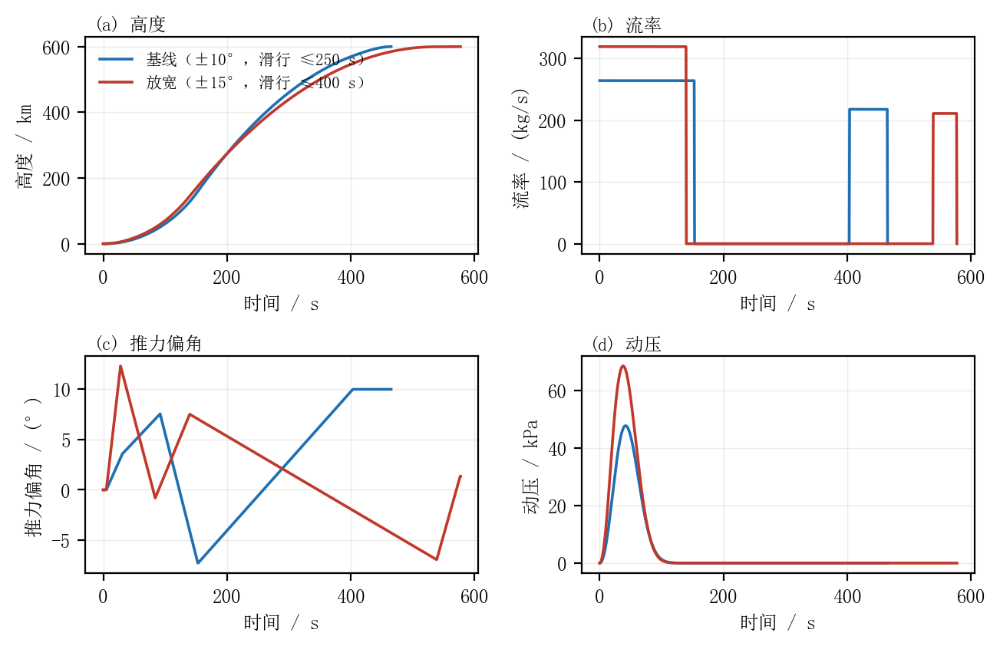

# 放宽 PSO 边界后的复算

## 1 动机

在 v0.1.0 的基线解里，三个设计变量贴在盒约束边界上：

| 变量 | 基线值 | 原上界 | 说明 |
|---|---:|---:|---|
| $\delta_4$（第二段起始偏角） | 10.000° | 10° | 触上界 |
| $\delta_5$（第二段末期偏角） | 9.9996° | 10° | 触上界 |
| $t_c$（滑行时长） | 250.000 s | 250 s | 触上界 |

这意味着基线的米级残差与燃料消耗，未必是物理极限，而可能是被人为边界截断的结果。
本实验只放宽边界、其余设置一律不变，用来回答一个具体问题：**多给的自由度会被用来
省燃料、降低过载，还是只是让终端残差更容易收敛？**

## 2 改动

| 文件 | 参数 | 原值 | 新值 |
|---|---|---|---|
| `config/rocket_config.m` | `p.deltaMax` | 10° | **15°** |
| `config/rocket_two_burn_config.m` | 偏角 1–5 的上下界 | $[0,-10,-10,-10,-10]$ / $[10,10,10,10,10]$ | $[0,-15,-15,-15,-15]$ / $[15,15,15,15,15]$ |
| 同上 | 第一段时长 $t_1$ | 80 / 180 s | 80 / **240 s** |
| 同上 | 滑行时长 $t_c$ | 20 / 250 s | 20 / **400 s** |
| 同上 | 第二段时长 $t_2$ | 25 / 120 s | 25 / **150 s** |

流率上下界（180/350 与 120/350 kg/s）与 `p.qMax` 未动——这是发动机的物理上限，
不属于"搜索范围"。

## 3 设置与可复现性

- 其余全部沿用基线：种群 96、180 代、停滞窗口 80、种子 161、PSO→SQP 流程、
  扰动种子 20261020、GPU 批量 RK4 粗筛 + CPU `ode45` 复核。
- 驱动脚本 `experiments/relaxed_bounds.m`，以 `saveResults=false`、`makeReport=false`
  运行，**不覆盖**基线的任何结果文件。
- 本机耗时 135.7 s（含启动），其中优化器内部计时 117.5 s；GPU 后端为 RTX 5060。
- 结果写入 `results/data/rocket_two_burn_relaxed.mat`（变量名 `r`）。

## 4 结果

### 4.1 汇总

| 指标 | 基线（±10°，$t_c\le250$） | 放宽（±15°，$t_c\le400$） | 变化 |
|---|---:|---:|---:|
| 入轨验收 `success` | 是 | 是 | — |
| 高度残差 | 0.265 m | 8.281 m | 变差 |
| 径向速度残差 | −0.021 m/s | +0.045 m/s | 同一量级 |
| 切向速度残差 | 0.046 m/s | 0.020 m/s | 略好 |
| 目标函数 $J$ | $3.30\times10^{-9}$ | $6.88\times10^{-7}$ | 两个数量级 |
| 关机时刻 | 465.258 s | 577.305 s | **+112.0 s** |
| 推进剂消耗 | 53 773.6 kg | 52 690.3 kg | **−1 083.3 kg（−2.0%）** |
| 终端质量 | 6 226.4 kg | 7 309.7 kg | +1 083.3 kg |
| 总冲量 | 242.0 MN·s | 237.1 MN·s | −2.0% |
| 峰值过载 | 15.90 g | 13.14 g | **−17.3%** |
| 峰值动压 | 47.79 kPa | 68.57 kPa | **+43.5%** |
| 瞬时密切偏心率 | $1.26\times10^{-5}$ | $8.69\times10^{-6}$ | 略好 |
| 近/远地点 | 599.998 / 600.174 km | 599.992 / 600.113 km | — |

### 4.2 设计变量

| 变量 | 基线 | 放宽 | 新边界 |
|---|---:|---:|---|
| $\delta_1$ | 3.561° | 12.321° | 0 / 15 |
| $\delta_2$ | 7.558° | −0.811° | ±15 |
| $\delta_3$ | −7.281° | 7.511° | ±15 |
| $\delta_4$ | 10.000° | −6.933° | ±15 |
| $\delta_5$ | 9.9996° | 1.354° | ±15 |
| $q_1$ | 263.96 kg/s | 319.08 kg/s | 180 / 350 |
| $q_2$ | 217.63 kg/s | 210.87 kg/s | 120 / 350 |
| $t_1$ | 153.28 s | 140.05 s | 80 / 240 |
| $t_c$ | 250.00 s | 398.42 s | 20 / 400 |
| $t_2$ | 61.98 s | 38.83 s | 25 / 150 |

放宽后**没有任何变量贴在新边界上**（最接近的是 $t_c=398.42$ 对 400，仍有 1.6 s 余量），
说明新解是内点解，不是又一次被边界截断。

### 4.3 轨迹对比



- **(a) 高度**：两条曲线在 0–140 s 几乎重合，之后放宽解以更低的高度爬升、滑行更久，
  最终在同一 600 km 会合。
- **(b) 流率**：放宽解把第一段从"264 kg/s × 153 s"改成"319 kg/s × 140 s"——
  更猛、更短；第二段则从"218 kg/s × 62 s"缩到"211 kg/s × 39 s"。
- **(c) 偏角**：形态完全不同。基线是"小幅顺航向 → 反向 −7.3° → 贴 +10° 圆轨化"；
  放宽解先打到 +12.3°，再回到 −0.8°，第二段从 −6.9° 起、收到 +1.4°。
- **(d) 动压**：放宽解的动压峰值从 47.8 kPa 升到 68.6 kPa，这是"更猛的第一段"
  在大气层内换来的代价。

### 4.4 物理解读：更接近"霍曼式"两段入轨

放宽解的阶段数据：

| 时刻 | 高度 | 径向速度 | 切向速度 | 航迹角 |
|---|---:|---:|---:|---:|
| 第一段关机（140.05 s） | 145.63 km | 2.32 km/s | 4.51 km/s | 27.3° |
| 第二次点火（538.48 s） | 599.60 km | −5.73 m/s | 4.22 km/s | −0.08° |
| 最终关机（577.31 s） | 600.01 km | 0.04 m/s | 7.56 km/s | 0.00° |

这条轨迹的结构是：低空猛烧 → 滑行 398 s 到**远地点**（径向速度几乎为零）→ 在远地点
圆化。第二段起始偏角为 −6.93°，即推力略高于当地水平——因为加速后所需向心加速度
$w^2/r$ 变大，必须补一点向外的径向分量，否则轨迹会下沉。这个负号不是笔误，是
"在远地点加速"的必然结果。

基线则不同：它在 571.6 km、径向速度仍有 +0.69 km/s 时就开始圆化，相当于在"还在爬升"
的阶段补速度，重力损失更大。于是燃料的 2% 节省有了明确来源——**把圆轨化推迟到远地点**；
代价同样明确——为了在远地点之前达到 600 km，第一段必须在稠密大气里烧得更猛，
动压因此从 47.8 kPa 升到 68.6 kPa。

## 5 解读

**（1）多出来的自由度主要被用来省燃料，而不是压残差。**
推进剂少用 1.08 t（占原消耗的 2.0%），总冲量同比例下降。节省的机理见 §4.4：
放宽解把圆轨化推迟到远地点，更接近霍曼转移，重力损失更小。
代价是飞行时间增加 112 s（+24%），以及动压峰值上升 43.5%。从工程角度，
这是一次典型的"时间/载荷 ↔ 燃料"权衡，而不是无条件的改进。

**（2）峰值过载下降 17%，但机理是"终端质量更大"，不是"推力更温柔"。**
放宽解把第二段燃烧缩短到 38.8 s，关机时质量 7.31 t（基线 6.23 t），
因此末端 $T/m$ 从 15.9 g 降到 13.1 g。两者都远离真实运载火箭 4–6 g 的承受范围，
说明"固定流率、不节流"的模型假设仍然主导着过载结果。

**（3）终端精度的差异源于 SQP 落入不同局部极小，而非搜索失败。**
值得注意的是：放宽后 PSO 单独在 `fast` 档就得到了 $J=8.2\times10^{-16}$
（残差 −4.3 m / −0.014 / 0.0064 m/s），看起来"精确到机器零"；但换用 `precise` 档复核，
起点其实是 $J=1.29\times10^{-6}$（约 11 m 量级），SQP 只把它降到 $6.88\times10^{-7}$。
这正好复现了论文 §7.1 的结论：**`fast` 档的"零残差"是积分误差，不是真精度**。
基线的 SQP 之所以能做到 0.265 m，是因为它进入了一个终端流形更容易逼近的盆地。

**（4）基线贴边界的根因被证实了。**
基线中 $\delta_4$、$\delta_5$、$t_c$ 触上界，本实验说明这些边界确实"卡住"了更省燃料的解：
仅放宽三处上界，就能在满足同一终端条件的前提下少烧 2% 推进剂。

## 6 后续处理

> 本节写于实验完成当下。后续已按第 3 条执行：**论文正文改为以放宽解为主结果**，
> 紧约束旧解保留在 §6.7 作对比；MPC 已在 398 s 滑行段的新参考上重跑
> （`experiments/relaxed_verify.m`），闭环位置 RMS 4.21 m、速度 RMS 0.089 m/s。
> 下面 1–3 条保留为当时的判断记录。

1. ~~不替换基线。~~ 当时的判断是：放宽解在燃料与过载上更好，但在动压与飞行时间上更差，
   且终端精度低一个数量级，宜作为灵敏度实验而非全面占优的新方案。实际处理是
   “以放宽解为主线、旧解作对照”，因为论文要讨论的正是**边界如何改变解的形状**。
2. 若要继续追这条线，应把目标改成"终端约束 + 燃料最小"，并**显式加入
   $q_d\le 50$ kPa 与 $T/m\le 6g$ 的约束**，否则优化器会继续用动压和过载换燃料。
3. 若采纳新参考，需在 398 s 滑行段上重跑 MPC 并核对 LTV 线性化的有效性，
   论文的 §6 与摘要数字同步更新。（已完成）

## 7 复现

```powershell
# 1) 应用放宽后的配置（见第 2 节）
# 2) 运行优化（约 2 min）
matlab -batch "run('experiments/relaxed_bounds.m')"
# 3) 滑行验证与 MPC（约 1 min）
matlab -batch "run('experiments/relaxed_verify.m')"
# 4) 生成对比表与图
python experiments/compare_relaxed.py
```

产物：`results/data/rocket_two_burn_relaxed.mat`、
`results/data/rocket_orbit_coast_relaxed.mat`、
`results/data/rocket_mpc_relaxed.mat`、`experiments/relaxed_vs_baseline.png`。
